# Dungeon Minimap

<!-- drh:show -->
A zoomable map with dungeon-specific palettes, walls, purple breakable-wall markers, chests, and party portraits. The footer shows gold and XP collected during the run.

Use **- / +** to zoom. At higher zoom, the map follows you. Drag inside the map to look around, or drag the header to move the panel. Drag a bottom corner to resize it. The mod remembers your layout and zoom.

Exit colors follow Xk's Minimap: orange for a trigger, purple for enemy kills, cyan for a breakable blocker, green for open, red for closed, and grey for unknown.

Press **Ctrl + Shift + M** or use **Enable minimap** in Settings to turn it on or off. Turning it off stops map rendering and updates.

Based on [Xk's Minimap](https://github.com/Xkaka505/DRH-Mod-Minimap). Use one minimap mod at a time. This mod can run alongside Party DPS Meter, which uses the same player colors.
<!-- /drh:show -->

## Preview

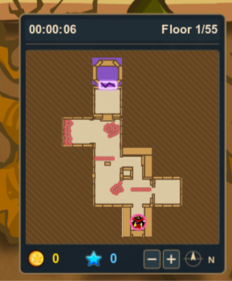

### Zoomed view

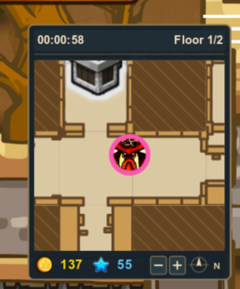

*Knight Fortress (zoomed in)*

### Hidden wall marker

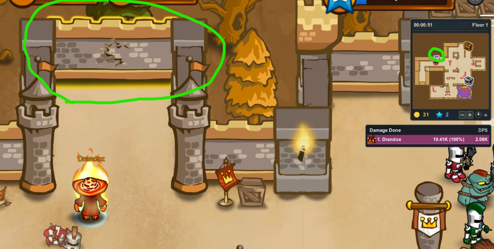

*Breakable walls are marked with a purple crack on the minimap.*

### Map themes

One screenshot per palette, ordered by first appearance in the campaign.

<table>
  <tr>
    <td align="center" width="25%"> Knight Fortress / Arena</td>
    <td align="center" width="25%">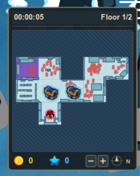 Caverns / Icewater Caverns</td>
    <td align="center" width="25%">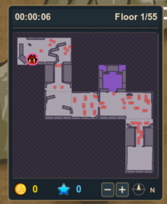 Dark Barrows / Barrows</td>
    <td align="center" width="25%">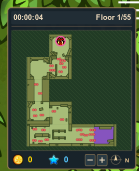 Twisted Jungle / Jungle</td>
  </tr>
  <tr>
    <td align="center" width="25%">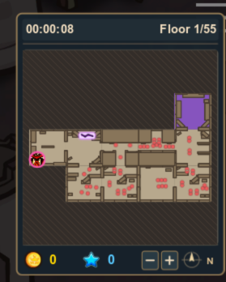 Prisoner's Keep / Prison</td>
    <td align="center" width="25%">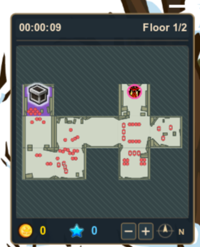 Battleheim</td>
    <td align="center" width="25%">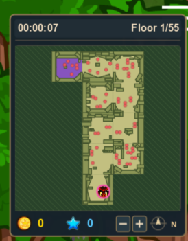 Cretaceous Park / Dino Park</td>
    <td align="center" width="25%">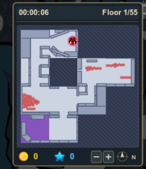 Frostgaard / Norse Nightmare</td>
  </tr>
  <tr>
    <td align="center" width="25%">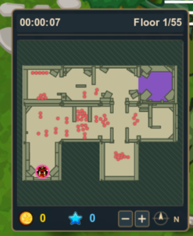 The Lost Ruins / Ruins</td>
    <td width="25%"></td>
    <td width="25%"></td>
    <td width="25%"></td>
  </tr>
</table>

Requires DRH 18 and Mod API 1.4.0 or a compatible later 1.x version. [GPLv3](LICENSE).
